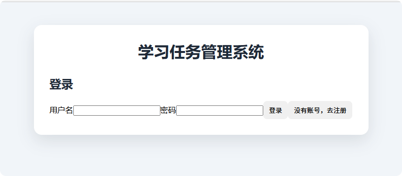
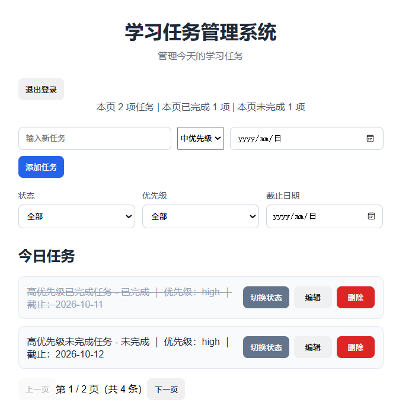

# 学习任务管理系统前端

基于 React 和 Vite，调用 FastAPI 后端完成用户认证与任务管理。

后端：[study-task-manager-backend](https://github.com/wen04115/study-task-manager-backend)

## 核心功能

- 用户注册、登录和退出
- 请求自动携带 JWT 登录凭证
- 登录凭证失效时返回登录页面并提示
- 新增、编辑、删除任务，切换完成状态
- 设置优先级和截止日期
- 按状态、优先级、截止日期筛选及分页展示
- 展示当前页任务数量和完成情况

## 技术栈

React、JavaScript、Vite、CSS、Fetch API。

## 本地运行

先按照后端 README 启动 MySQL 和 FastAPI，后端地址为：

http://127.0.0.1:8000

在前端项目根目录安装依赖并启动：

```powershell
npm install
npm run dev
```

浏览器打开终端实际显示的 Local 地址。

如果端口被占用，Vite 可能选择其他端口；后端 CORS 配置需要允许对应的前端地址。

## 登录与数据隔离

- 没有账号时，可在登录页面切换到注册表单
- 注册成功后，使用新账号登录
- JWT 只保存在页面内存中，刷新后需要重新登录
- 退出登录会清除前端登录状态和任务页面状态
- 退出不会在服务端立即作废已签发的 JWT
- 任务归属由后端根据当前登录用户确定
- 用户隔离由后端执行，不依赖前端隐藏数据

## 手动验证

1. 注册并登录账号 A，创建一条测试任务。
2. 验证编辑、切换状态和删除功能。
3. 退出后登录账号 B，确认看不到账号 A 的任务。
4. 刷新页面，确认需要重新登录。

## 项目截图

### 登录与注册入口



### 任务管理

